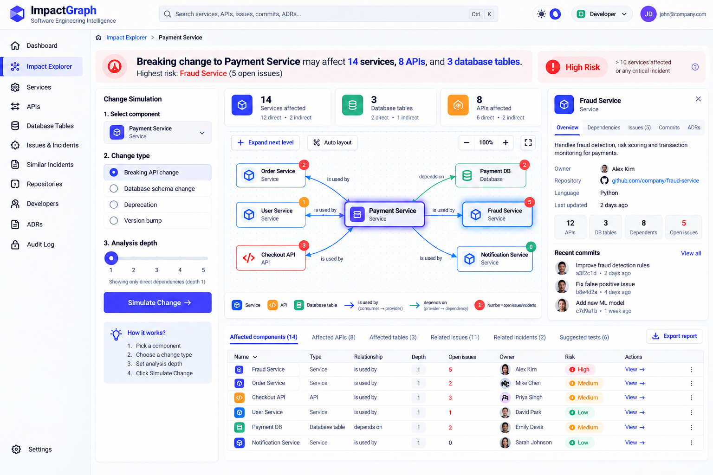

# ImpactGraph — Complete Frontend Design Specification

> **Visual reference — the frontend must look like this.** The screenshot below is the target design for the Impact Explorer and the overall look (header, sidebar, cards, graph, drawer, report table). Where this image and the written spec differ on *appearance*, follow the image. Where they differ on *behaviour*, follow the written spec. See "Addendum A" at the end for details.
>
> 

## 1. Product Overview

ImpactGraph is a Software Engineering Knowledge and Code Intelligence Platform that helps developers understand how a change in one part of a software system could affect other parts.

The primary purpose of the platform is to answer a simple question:

**“If I change this service, API, or database table, what else could be affected?”**

The platform represents the relationships between microservices, APIs, database tables, repositories, developers, commits, issues, incidents, and Architecture Decision Records (ADRs).

It also helps developers find similar past incidents and reuse previous debugging knowledge.

The frontend should look like a professional engineering tool while remaining understandable to first-time users. The interface should prioritize clarity, guided workflows, readable dependency graphs, and actionable results instead of showing too much technical information at once.

## 2. Overall Visual Design

Use a clean, light-themed interface as the default for demonstrations, classrooms, and projector presentations. Also provide a dark-theme option for developers who prefer it.

The design should feel modern, professional, and trustworthy, similar to Linear, GitHub, and other high-quality developer tools.

Use a white or very light grey background, subtle borders, restrained shadows, rounded corners, and dark text with strong contrast.

Use indigo or blue as the primary accent color for buttons, links, selected navigation items, and interactive elements.

Reserve red, amber, and green for risk and status indicators. Never rely on color alone; accompany each indicator with text or an icon.

Use a consistent spacing system based on 4, 8, 12, 16, and 24 pixels. Use readable typography, larger headings, and compact but comfortable tables. Use monospace fonts only for technical identifiers, API paths, commit hashes, and code-related values.

The interface must be optimized for a desktop screen measuring 1366 × 768 pixels and remain usable on tablets.

Avoid unnecessary gradients, excessive animations, decorative charts, crowded panels, and too many competing colors.

## 3. Main Application Layout

The application should have three main structural elements: a navigation sidebar, a top header, and a central workspace.

### Navigation sidebar

Place a collapsible navigation sidebar on the left.

Include the following navigation items:

- Dashboard
- Impact Explorer
- Services
- APIs
- Database Tables
- Issues & Incidents
- Similar Incidents
- Repositories
- Developers
- ADRs
- Audit Log
- Settings

Use simple line icons and clear text labels. Highlight the active page using a subtle indigo background and a visible active indicator.

The sidebar should collapse to an icon-only view when the user needs more workspace.

Hide administrative navigation and actions from the Developer role when they are not permitted.

### Top header

The top header should contain the ImpactGraph logo, global search, theme toggle, role switcher, and user profile.

The global search should display a keyboard shortcut such as Ctrl+K or Cmd+K.

The role switcher should support the Admin and Developer demo roles. Display the current role as a readable badge.

Keep the header compact so it does not consume too much vertical space.

### Main workspace

Every page should have a clear title, breadcrumbs where useful, and one primary action.

Use consistent page layouts, buttons, tabs, form controls, tables, loading skeletons, empty states, and error messages throughout the application.

## 4. Login Page

Create a clean login page with the ImpactGraph logo and a short product description.

Use a centered login card containing:

- Email address field
- Password field
- Role selection for Admin or Developer demo access
- Sign In button
- A short note explaining that the environment uses mock authentication

Provide inline validation for required fields and invalid email formats.

After successful demo login, navigate to the Dashboard. This is a prototype login flow and must not be presented as production-grade authentication.

## 5. Dashboard

The Dashboard should provide a quick overview of the software system and help users identify problems requiring attention.

Start with a heading such as “System Overview” and a short description of the current system health.

At the top, display four compact summary cards:

- Open incidents
- Total services
- Critical issues
- Average Mean Time to Resolution (MTTR)

Each card should display a clear number, a descriptive label, and a useful comparison or contextual detail when available. Clicking a card should navigate to the corresponding filtered view.

Below the summary cards, create a two-column layout.

On the left, display a bar chart showing incidents grouped by service. Use readable service labels, clear axes, and tooltips.

On the right, display a component hotspot table ranking components using commit activity and bug counts. Show the component name, recent change activity, open bugs, and risk level.

Below these sections, include a bus-factor warning list identifying components maintained by only one contributor. Provide a link to inspect each component's owners and recent activity.

Place recent audit events in a compact activity feed showing who performed an action, what changed, and when.

Keep the Dashboard informative but avoid turning it into a wall of charts and statistics.

## 6. Impact Explorer — The Main Feature

The Impact Explorer is the most important screen in ImpactGraph. It should receive the most design attention and screen space.

Its purpose is to help a developer simulate a proposed change and understand the possible consequences.

### Initial state

When the user first opens the Impact Explorer, show a short instruction:

“Choose a component, select the type of change, and simulate its impact.”

Provide a component selector that supports searching for services, APIs, and database tables.

Below it, display a change-type selector with these options:

- Breaking API change
- Database schema change
- Deprecation
- Version bump

Include an analysis-depth slider from 1 to 5. Set the default depth to 1 so the initial graph is easy to understand.

Add one prominent primary button labeled “Simulate Change.”

Before a component has been selected, show a helpful empty state explaining what the user needs to do.

After selection, collapse the component-selection controls into a compact picker when appropriate, leaving more space for the graph.

### Impact summary

After simulation, place a prominent plain-language sentence above the graph.

For example:

“Breaking change to Payment Service may affect 14 services, 8 APIs, and 3 database tables. Highest risk: Fraud Service, with 5 open issues.”

All numbers must come from the same impact-analysis result set. Do not hard-code summary counts independently from the graph or table.

Beside or below the summary, show three compact metrics:

- Services affected
- Database tables affected
- Open incidents affected

Display one clearly defined risk badge with a text label such as Low, Medium, or High.

Define the risk classification in a visible tooltip or explanation. For example, High Risk may mean more than 10 affected services or at least one critical incident. Use a consistent rule in both the UI and the mock-data logic.

### Dependency graph

Place the dependency graph in the center of the workspace and give it the largest available area.

Use React Flow with custom nodes and automatic layout using dagre.

Represent each component with a readable card containing its name, component type, and a small icon.

Use distinct icons for services, APIs, and database tables. Highlight the selected component with a clear border and subtle emphasis.

Show only direct dependencies by default. Provide an “Expand next level” action that reveals the next level of affected components. Allow users to expand further or change the analysis depth.

Keep unrelated nodes hidden or visually de-emphasized when useful.

Use consistent directional arrows. Prefer simple relationship labels such as “depends on” and “is used by,” with a consistent explanation of arrow direction.

Include a compact legend explaining the selected component, affected components, dependency depth, and any issue-count badges. If a node displays a number, explain what that number represents, such as open issues.

Provide zoom, pan, reset-view, auto-layout, and minimap controls. Keep the controls grouped together instead of scattering them around the graph.

Support loading skeletons while the graph is being prepared, an empty state when no dependencies exist, and a clear error state with a retry action when the simulation fails.

### Node details

Do not show a permanent details panel when no node is selected. This allows the graph to occupy more space.

When the user clicks a node, open a right-side details drawer or panel.

The panel should display:

- Component name and type
- Short description
- Owner
- Repository link
- Last updated time
- Number of dependent components
- Open issues and incidents
- Recent commits
- Linked ADRs

Include links to the relevant component detail page and related records.

Allow the user to close the panel without losing the graph's current state.

### Affected-components report

Below the graph, display a compact results table with tabs for:

- Affected components
- Affected APIs
- Affected database tables
- Related issues
- Related incidents
- Suggested tests

For each affected component, show its name, type, relationship, dependency depth, open issues, owner, and risk level.

Make table rows clickable so users can inspect a component.

Provide sorting, filtering, and pagination when the result set is large.

The report should be derived from the same simulation result as the graph and summary. If the system recommends regression tests, label them as suggestions unless actual test discovery has been implemented.

## 7. Component Detail Page

Every service, API, and database table should have a dedicated detail page.

The header should display the component name, component type, owner, repository link, and a short description.

Provide tabs for:

- Overview
- Dependencies
- Commits
- Issues
- Incidents
- ADRs
- Owners

The Overview tab should display a concise component summary, key metrics, recent activity, and current risk indicators.

The Dependencies tab should separate incoming dependencies from outgoing dependencies and explain which components depend on the selected component and which components it depends on.

The Commits tab should show commit messages, authors, timestamps, and links to repositories.

The Issues and Incidents tabs should show related records with status and severity.

The ADRs tab should list architectural decisions associated with the component.

The Owners tab should display contributors and their responsibilities, making single-contributor components easy to identify.

Admins may receive editing actions according to their permissions. Developers should have read-only access to component metadata and impact analysis.

## 8. Issues and Incidents

Create a shared Issues & Incidents page with separate tabs or clearly separated views.

At the top, provide search and filters for service, severity, status, owner, and date range.

Use a sortable, paginated table with the record ID, title, type, service, severity, status, owner, and creation time.

Use clearly labeled severity indicators and status badges.

Admins should be able to create, edit, and delete records where permitted. Developers should be able to report new issues and incidents but should not have unrestricted editing or deletion privileges.

Forms should validate required fields and supported enum values.

Use a clear status workflow with only valid transitions available.

After a successful operation, display a toast confirming what happened. If validation fails, explain the problem near the relevant field.

Before destructive actions, display a confirmation dialog.

If deletion is blocked because an API still has consumers, show a clear error banner explaining why deletion is blocked and link to the dependent components. Do not silently delete dependent records.

## 9. Similar Incidents

Create a page that helps developers reuse knowledge from previous failures.

At the top, provide a text area where the user can paste a bug description or incident summary. Also allow the user to select an existing issue or incident as the search input.

Include filters for service and severity, plus a control for the number of results to display.

Provide a primary button labeled “Find Similar Incidents.”

Display the matching incidents as compact cards or a table. Each result should include:

- Incident title and ID
- A similarity score
- Service and severity
- Incident summary
- Root cause, if available
- Resolution or fix applied
- Link to the original incident

Use readable similarity bars and numeric scores together. Explain that similarity indicates relevance rather than a guarantee that two incidents share the same cause.

For the mock frontend, use deterministic sample similarity results. The architecture should allow a future vector-search API to replace the mock implementation.

Include empty, loading, and error states.

## 10. Global Search

Implement a global command palette that opens using Ctrl+K on Windows/Linux and Cmd+K on macOS.

The palette should allow keyword search across services, APIs, issues, commits, and ADRs.

Group results by type and show a recognizable icon, title, short matching excerpt, and relevant identifier.

Highlight matched words in the result text.

Allow keyboard navigation using the arrow keys, Enter to open a result, and Escape to close the palette.

Display a helpful empty state when there are no matches.

The search should be fast and accessible, with proper focus management and visible keyboard focus indicators.

## 11. Admin Audit Log

Create an audit log page available only to the Admin role.

Display a table containing the actor, action, affected entity, previous value where appropriate, new value where appropriate, and timestamp.

Provide filters for actor, action type, entity type, and date range.

If a trigger-style event flags dependent services for review, show a prominent informational banner such as:

“5 dependent services flagged for review.”

The count and affected services should come from the audit event data.

Allow an administrator to inspect the related event and navigate to the affected services.

For this frontend prototype, audit entries can be generated from mock operations. Make it clear that the audit log is simulated rather than a production security audit trail.

## 12. Roles and Permissions

Implement two demo roles.

**Admin:** Can view all screens, create and edit components and dependencies, manage issues and incidents, perform permitted deletions, and view the audit log.

**Developer:** Can view components and dependencies, run impact simulations, use search, find similar incidents, and report issues and incidents. The Developer role should not see unauthorized administrative actions.

Role selection should be visible in the header. Switching roles in the demo should update the visible navigation and available actions consistently.

Implement role checks in the mock data-access layer as well as the UI. Do not describe mock role switching as real authentication or authorization.

## 13. Shared Components and Interactions

Use reusable components for:

- Buttons and form fields
- Summary metrics
- Status and severity badges
- Data tables
- Tabs
- Breadcrumbs
- Search inputs
- Confirmation dialogs
- Toast notifications
- Loading skeletons
- Empty states
- Error banners
- Side drawers
- Component cards

Every interactive control must have a clear purpose and produce an observable result.

Use accessible labels for icon-only buttons, keyboard-operable controls, appropriate focus management, and sufficient text contrast.

When a list is empty, explain why and provide a relevant next action. When an operation fails, use plain language and offer recovery steps where possible.

Keep animations subtle and short. Respect reduced-motion preferences.

## 14. Technical Implementation

Build the frontend with Next.js App Router and TypeScript.

Use Tailwind CSS and shadcn/ui for consistent styling and reusable UI primitives.

Use React Flow from @xyflow/react for the dependency graph, dagre for automatic layout, Recharts for dashboard charts, TanStack Table for data tables, and lucide-react for icons.

Store mock data in `/lib/mock-data.ts` and expose it through a small typed data-access layer, for example `/lib/data-access.ts`.

Use shared TypeScript models for services, APIs, database tables, repositories, developers, commits, issues, incidents, ADRs, dependency relationships, and impact-analysis results.

Generate approximately 30 connected services, their related APIs and tables, 100 or more issues and incidents combined, and 10 ADRs. Use stable identifiers and consistent relationships across all pages.

Implement impact analysis as a separate utility or service that traverses the dependency graph according to the selected component, change type, and depth.

The graph, headline, summary metrics, risk classification, and affected-components report must all use the same simulation result.

Keep mock-data access separate from UI components so future API routes can replace the mock implementation without rewriting the entire frontend.

Do not hard-code secrets or credentials. Validate inputs and handle errors explicitly.

## 15. Final User Experience

The overall experience should guide users from a question to an actionable result.

A typical workflow should be:

1. The user opens Impact Explorer.
2. The user selects a component such as Payment Service.
3. The user chooses Breaking API Change.
4. The user clicks Simulate Change.
5. ImpactGraph calculates the reachable affected components using the dependency graph.
6. The user sees a plain-language impact summary and risk classification.
7. The graph initially displays direct dependencies.
8. The user expands additional dependency levels if needed.
9. The user clicks an affected component to inspect its owner, issues, commits, incidents, and ADRs.
10. The user reviews the affected-components report and suggested next steps.

The user should always understand what they selected, what the system calculated, why something is considered risky, and what to investigate next.

## Final Design Principle

**ImpactGraph should feel like a guided engineering assistant, not a complicated monitoring dashboard.**

The visual design should be clean, the graph should explain relationships clearly, the impact results should be consistent, and advanced technical information should appear when users need it rather than all at once.

---

# Addendum A — Visual reference notes (added after the teammate's spec was locked)

The sections above are the teammate's locked specification, unchanged. This addendum only records what the reference image (`impactgraph-reference.png`) shows, so the build matches it.

## A1. What the reference image shows (Impact Explorer, "Payment Service" selected)

**Header (full width, compact):** logo mark + "ImpactGraph / Software Engineering Intelligence" at left; wide global search box with a `Ctrl` `K` hint; theme toggle (sun / moon); a role badge with dropdown ("Developer"); user avatar with initials and email at the far right.

**Left sidebar:** Dashboard, Impact Explorer (active: indigo background + left indicator), Services, APIs, Database Tables, Issues & Incidents, Similar Incidents, Repositories, Developers, ADRs, Audit Log, with Settings pinned at the bottom. Simple line icons.

**Breadcrumb:** Impact Explorer › Payment Service.

**Top row:**
- A light-red impact banner with an alert icon. Headline: "Breaking change to **Payment Service** may affect **14 services**, **8 APIs**, and **3 database tables**." Sub-line: "Highest risk: **Fraud Service** (5 open issues)". Numbers are highlighted in the accent color.
- A separate risk card at the right: red **High Risk** badge, the rule text ("> 10 services affected or any critical incident") and a help (?) icon.

**Left column — "Change Simulation" panel:**
1. Select component: dropdown showing the chosen component with its type icon and type label.
2. Change type: four radio rows (Breaking API change, Database schema change, Deprecation, Version bump).
3. Analysis depth: slider with ticks 1–5 and a caption ("Showing only direct dependencies (depth 1)").
4. Big indigo **Simulate Change →** button.
5. A light "How it works?" box with the 4 numbered steps (Pick a component, Choose change type, Set analysis depth, Click Simulate Change).

**Centre column:**
- Three metric cards, each with a coloured icon tile, big number, label and a direct / indirect split: **Services affected** (e.g. 12 direct · 2 indirect), **Database tables** (2 direct · 1 indirect), **APIs affected** (6 direct · 2 indirect).
- Graph toolbar: "+ Expand next level", "Auto layout", zoom out / `100%` / zoom in, fit-to-screen.
- Dependency graph: the selected component in the centre with a strong indigo border and glow; connected component cards around it. Each card has a type icon (service = cube, API = code brackets in orange, database = cylinder in green), name and type label, and a small red/amber/green **count badge** (open issues/incidents). Edges are curved arrows with labels "is used by" / "depends on".
- Legend strip under the graph: Service, API, Database table icons; arrow meaning for "is used by (consumer → provider)" and "depends on (provider → dependency)"; "Number = open issues/incidents".

**Right column — node details drawer (opens on node click, with a close ✕):** component name + type, tabs (Overview, Dependencies, Issues (n), Commits, ADRs), description, Owner (avatar + name), Repository link, Language, Last updated, four mini stats (APIs, DB tables, Dependents, Open issues), and "Recent commits" with author avatar, message, short hash and relative time, with a "View all" link.

**Bottom — report:** tabs with counts — Affected components (14), Affected APIs (8), Affected tables (3), Related issues (11), Related incidents (2), Suggested tests (6) — and an **Export report** button at the right. Table columns: Name (with type icon), Type, Relationship, Depth, Open issues, Owner (avatar + name), Risk (coloured badge with text), Actions ("View →" and a ⋮ menu).

**Style:** light theme, white cards on a very light grey background, thin borders, soft shadows, rounded corners, indigo primary, red/amber/green only for risk and status, every risk/status shown with text as well as colour.

## A2. How the image maps onto the real database

The image was drawn with example values. The real app uses the PostgreSQL database, so:

- **All numbers, names and counts are examples.** Real values come from the database (for example `get_impact()` for affected services). The headline, metric cards, graph, risk badge and report tabs must all come from the same simulation result.
- **Metric cards:** show Services affected, Database tables affected and APIs affected as in the image. The spec's "Open incidents affected" must still appear (in the headline/risk explanation, in the "Related incidents" tab, and as a badge on nodes).
- **"Language" in the drawer** has no column in the schema. Omit it, or show it only if a language is derived from data that really exists. Do not invent values.
- **Avatars:** the database has no photos. Show a circle with the person's initials.
- **Owner:** for a service this is `services.maintainer_id` (a developer). For an API or table, use the owner of its parent service.
- **Direct vs indirect:** direct = dependency depth 1; indirect = depth 2 or more.
- **Risk rule** shown in the tooltip must match the rule implemented on the server (one shared function).
- **Role badge:** the image shows a role dropdown because the original spec used mock roles. In the real app this badge shows the signed-in user's actual role (Admin or Developer) from the login session. It is not a switcher.
- **Export report:** export the current simulation result (CSV at minimum).
- **Suggested tests:** keep labelled as suggestions (no real test discovery exists).

## A3. Scope note

The written spec asks for mock data and mock authentication. For the DBMS project these are replaced by the real PostgreSQL database and real login (see the build prompt). Everything else in the spec (screens, components, behaviour, accessibility, design principles) still applies in full.
